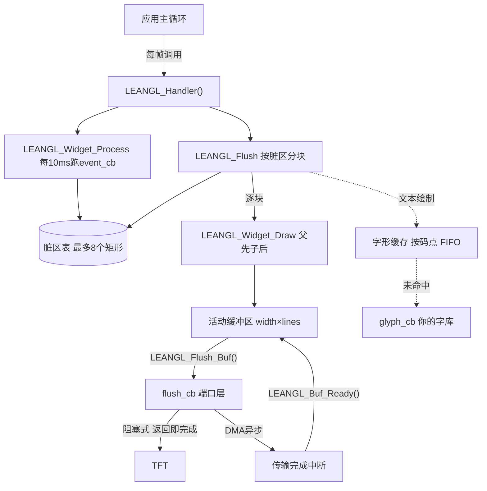

<div align="center">

# LeanGL

**面向 MCU 的轻量级 TFT GUI 库 —— 分块刷新、脏区重绘、自带 Win32 屏幕模拟器**

[](#)
[](#)
[](#测试与模拟器)
[](#资源占用)
[](#risc-v-交叉编译)

</div>

---

## 这是什么

LeanGL 是一个为资源受限 MCU 设计的**缓冲式** GUI 库。它不假设你有外部 SDRAM、不要求 RTOS、不依赖动态内存分配，只需要：

- 一块横向条带缓冲区（宽 × N 行，双缓冲则 2×N 行）
- 一个把像素带送到屏幕的回调
- 一个毫秒时钟

在只有几十 KB RAM 的芯片上，它能把整个界面跑起来——因为屏幕是**按脏区分块重绘**的，一帧里没变的区域根本不会被碰。

## 特性

| 特性 | 说明 |
| :--- | :--- |
| **脏区重绘** | 最多 8 个互不相交的矩形，自动裁剪合并；逐块清除，保留扫描期间的新脏标记 |
| **分块刷新** | 屏幕按缓冲区行数切带，只处理与脏区相交的带 |
| **双缓冲 + DMA** | 异步模式下支持"上一块还在发、下一块已经画"，缓冲区忙时记住断点，下轮从断点续刷 |
| **零动态分配** | 所有存储由调用方提供，库内部无 `malloc` |
| **UTF-8 排版** | 按 Unicode 码点绘制，中英混排各自使用自己的宽度，自动折行与省略号 |
| **字形缓存** | 同一码点只查一次字库，对付 SPI Flash 字库的外部读取延迟 |
| **控件树** | 父子层级、可见性继承、绘制顺序可控；自定义控件只需实现两个回调 |
| **主机模拟器** | Win32 窗口模拟 TFT 屏，可注入字库读取、光栅化、刷屏延迟，还原 MCU 时序 |

## 架构



## 快速开始

### 引入项目

**方式一：源码集成**（最常见）

```cmake
add_subdirectory(path/to/LeanGL)
target_link_libraries(your_app PRIVATE LeanGL::leanGL)
```

**方式二：安装后使用**

```powershell
cmake --preset host
cmake --build --preset host
cmake --install build/host --prefix D:/sdk/leangl
```

```cmake
find_package(LeanGL REQUIRED)
target_link_libraries(your_app PRIVATE LeanGL::leanGL)
```

`LeanGL::leanGL` 会自动带上 include 路径与 `LEANGL_FLUSH_ASYNC` 等 PUBLIC 定义，不需要手工 `-I`。

### 最小示例

```c
#include "leangl.h"
#include <string.h>

/* ---- 1. 端口层：把一条像素带送到屏幕 ---- */
static void lcd_flush(uint16_t y, uint16_t h, const uint8_t *data)
{
    /* data 是 h * screen.width 个 RGB565 像素，起始行 y */
    lcd_set_window(0, y, LCD_WIDTH - 1, y + h - 1);
    lcd_write_pixels(data, (uint32_t)h * LCD_WIDTH * LEANGL_COLOR_BYTES);
}

/* ---- 2. 字库：给一个字模 ---- */
static uint8_t font_glyph(const LEANGL_Font_t *font, LEANGL_CodePoint_t ch,
                          LEANGL_Glyph_t *out)
{
    const uint8_t *bits = flash_font_lookup(ch, &out->size.w, &out->size.h);
    if (bits == NULL)
        return 0;                       /* 无此字，库会跳过 */
    memcpy(out->bits, bits, (size_t)((out->size.w + 7) / 8) * out->size.h);
    return 1;
}

static const LEANGL_Font_t k_font = LEANGL_FONT_INIT(16, font_glyph, NULL);

/* ---- 3. 绘图缓冲：双缓冲，每块 16 行 ---- */
static uint8_t s_fb[LCD_WIDTH * 16 * LEANGL_COLOR_BYTES * 2];

/* ---- 4. 控件 ---- */
static LEANGL_Label_t  s_title;
static LEANGL_Button_t s_btn;

static void on_click(LEANGL_Button_t *btn) { (void)btn; /* ... */ }

void app_init(void)
{
    LEANGL_Set_Screen(LCD_WIDTH, LCD_HEIGHT);
    LEANGL_Set_Flush_CB(lcd_flush);
    LEANGL_Set_Font(&k_font);
    LEANGL_Set_Tick_CB(millis);                 /* 或用 LEANGL_Tick_Inc() */
    LEANGL_Buffer_Set(s_fb, sizeof s_fb, 1);    /* 1 = 双缓冲 */

    static const LEANGL_Rect_t r_title = {8, 8, 232, 32};
    LEANGL_Label_Init(&s_title, &r_title, "你好，LeanGL");
    LEANGL_Label_Set_Transparent(&s_title, 1);
    LEANGL_Widget_Add(&s_title.base);

    static const LEANGL_Rect_t r_btn = {8, 48, 232, 88};
    LEANGL_Button_Init(&s_btn, &r_btn, "开始");
    LEANGL_Button_On_Click(&s_btn, on_click);
    LEANGL_Widget_Add(&s_btn.base);
}

void app_loop(void)
{
    LEANGL_Handler();      /* 事件处理 + 分块刷新，每帧调一次即可 */
}
```

主循环里**只需要** `LEANGL_Handler()`：它内部已经包含控件事件处理与刷新调度，不需要再手动调 `LEANGL_Widget_Process()` 或 `LEANGL_Flush()`。

## 两种刷新模式

由编译期宏 `LEANGL_FLUSH_ASYNC` 决定，默认 **0（阻塞式）**：

| | `LEANGL_FLUSH_ASYNC = 0` | `LEANGL_FLUSH_ASYNC = 1` |
| :--- | :--- | :--- |
| `flush_cb` 语义 | 返回时像素已发出 | 只负责启动传输 |
| 缓冲区解忙 | 库自动 | 必须在完成中断里调 `LEANGL_Buf_Ready()` |
| 能否并发绘制 | 否 | 是 |
| 适用场景 | SPI 轮询、内存映射屏 | SPI + DMA、FSMC + DMA |

开启方式（任选其一）：

```powershell
# ① 配置时传入缓存变量：根 CMakeLists 会把它作为 PUBLIC 定义挂到 leanGL 上，
#    库与使用方看到同一个值
cmake --preset riscv -DLEANGL_FLUSH_ASYNC=1
```

```cmake
# ② 作为子项目引入时，在 add_subdirectory 之前设置
set(LEANGL_FLUSH_ASYNC 1 CACHE STRING "")
add_subdirectory(path/to/LeanGL)
```

```c
/* ③ 改 leanlg_conf.h 里的默认值，适合整个工程统一用一种模式 */
#define LEANGL_FLUSH_ASYNC 1
```

> **不要**只在自己的应用目标上 `target_compile_definitions(app PRIVATE LEANGL_FLUSH_ASYNC=1)`——这个宏决定的是**库源码**的编译结果，两边取值不一致会让缓冲区忙标志的语义对不上（例如应用以为要调 `LEANGL_Buf_Ready()`，库却在回调返回后自动清忙）。

> **DMA 注意**：完成顺序必须与发起顺序一致（单通道 DMA 天然如此）。若连续发起两次传输却只调一次 `LEANGL_Buf_Ready()`，另一块会一直停在忙状态。

## 配置项

大部分配置在仓库根目录的 `leangl_conf.h` 中，用 `#ifndef` 保护，可用 `-D` 覆盖；
颜色格式与事件周期是直接定义，如需修改请编辑该文件：

| 宏 | 默认 | 说明 |
| :--- | :--- | :--- |
| `LEANGL_COLOR_FORMAT_RGB565` | `1` | 16 位色，2 字节/像素 |
| `LEANGL_COLOR_FORMAT_RGB888` | 未定义 | 24 位色，3 字节/像素；定义后优先 |
| `LEANGL_RGB565_BIG_ENDIAN` | `1` | 高字节在前；若红蓝互换就调反 |
| `LEANGL_GLYPH_CACHE_SIZE` | `8` | 字形缓存条目，0 表示关闭；每条约 136 字节 |
| `LEANGL_EVENT_PERIOD_MS` | `10` | 控件事件处理周期 |
| `LEANGL_FLUSH_ASYNC` | `0` | 见上一节 |
| `LEANGL_DIRTY_MAX` | `8` | 脏区表容量（`leangl_dirty.h`） |
| `LEANGL_MAX_FONT_W/H` | `32` | 字模尺寸上限（`leangl_font.h`） |

## 控件一览

| 控件 | 头文件 | 要点 |
| :--- | :--- | :--- |
| 标签 | `leangl_label.h` | UTF-8 多行，`\n` 换行、自动折行、可透明背景 |
| 按钮 | `leangl_button.h` | 普通/按下两态，`Press`/`Release`/`Cancel` 由应用按输入时序调用 |
| 列表 | `leangl_list.h` | 每项一行，选中高亮，超出可见行数自动滚动，放不下画省略号 |
| 滚动标签 | `leangl_scroll_label.h` | 单行跑马灯，`[文本][间隙][文本]` 无缝循环 |
| 自定义控件 | `leangl_widget.h` | 把 `LEANGL_Widget_t` 放第一个成员，实现 `draw_cb` / `event_cb` |

控件不自己解析输入。触摸或按键到来时，由应用调用对应函数（如 `LEANGL_Button_Press()`），控件负责状态机与重绘。

### 自定义控件

```c
typedef struct {
    LEANGL_Widget_t base;        /* 必须是第一个成员 */
    LEANGL_Color_t color;
} MyPanel_t;

static void my_draw(LEANGL_Widget_t *w)
{
    MyPanel_t *p = (MyPanel_t *)w;
    LEANGL_Fill_Rect(&w->area, p->color);
}

static uint8_t my_event(LEANGL_Widget_t *w)
{
    (void)w;
    return 0;                    /* 返回 1 表示内容变了，库会自动标脏 */
}

void my_panel_init(MyPanel_t *p, const LEANGL_Rect_t *area, LEANGL_Color_t c)
{
    LEANGL_Widget_Init(&p->base, area, my_draw, my_event);
    p->color = c;
    LEANGL_Widget_Add(&p->base);
}
```

## 资源占用

Release 构建、`-march=rv32imafc -mabi=ilp32f`、全模块链接的参考值：

| 段 | 大小 |
| :--- | ---: |
| `.text`（代码 + 字模常量） | ≈ 11.2 KB |
| `.data` | 38 B |
| `.bss`（字形缓存 + 内部状态） | ≈ 1.2 KB |

不含绘图缓冲区与字库。缓冲区大小由你决定：`width × lines × 2`，双缓冲再乘 2。若链接器启用了 `-ffunction-sections -fdata-sections` + `--gc-sections`，未使用的控件会被自动裁掉。

## 构建

```powershell
# 主机：库 + 单元测试 + Win32 模拟器
cmake --preset host
cmake --build --preset host
ctest --preset host

# 主机 Release
cmake --preset host-release

# RISC-V 交叉编译（只产出静态库）
cmake --preset riscv
cmake --build --preset riscv
```

产物统一在 `build/<preset>/{bin,lib}`。

### RISC-V 交叉编译

工具链文件是 `cmake/toolchain-riscv-none-embed.cmake`，默认指向 MounRiver Studio 3 自带的 `riscv-none-embed-gcc`。换工具链只需覆盖路径：

```powershell
cmake -B build/mytool -G "MinGW Makefiles" `
      -DCMAKE_TOOLCHAIN_FILE=cmake/toolchain-riscv-none-embed.cmake `
      -DLEANGL_RISCV_TOOLCHAIN_DIR=D:/path/to/toolchain/bin `
      -DLEANGL_RISCV_TOOLCHAIN_PREFIX=riscv-none-elf-
```

也可用环境变量 `RISCV_TOOLCHAIN_DIR`。架构与 ABI 同样可覆盖：`LEANGL_RISCV_ARCH`、`LEANGL_RISCV_ABI`。

## 测试与模拟器

测试需要**主机 ABI**，与交叉构建目录严格分开（CMake 会在配置阶段拦下冲突组合）。

```powershell
cmake --preset host && cmake --build --preset host && ctest --preset host
```

9 个用例，覆盖分块刷新的 DMA 语义、字形缓存命中数、配置解析，以及模拟器的四种工况。

### Win32 屏幕模拟器

用真实窗口模拟 TFT 屏，并把 MCU 上的**时间特性**也模拟出来：

```powershell
build/host/bin/leanGL_sim.exe                 # 交互模式
build/host/bin/leanGL_sim_async.exe           # DMA 异步版本
build/host/bin/leanGL_sim.exe --selftest      # 无窗口自检，CI 可用
```

延迟由 `tests/sim/sim_config.ini` 注入，单位微秒：

```ini
[display]
width  = 240
height = 320
band_lines = 40          ; 0 = 按高度自动取 1/8

[timing]
flash_latency_us  = 150  ; 每次从外部 SPI Flash 取字模
raster_latency_us = 80   ; 字形光栅化（GDI 回退路径的缓存未命中）
flush_latency_us  = 1200 ; 每条像素带传屏
busy_wait = 1            ; 1 = 忙等（裸机）  0 = Sleep（让出 CPU）

[font]
path = ../assets/unifont.hex   ; 相对本文件解析

[log]
verbose = 0
```

命令行参数优先于配置文件：`--config`、`--size`、`--band-lines`、`--flush-latency`、`--no-delay`、`--font`、`--verbose`。

`--selftest` 会把整屏标脏跑若干帧，断言**每条像素带都至少刷到过一次**并打印耗时分解——这就是刷新饥饿的回归防线：

```
自检完成：7 轮，9 条像素带被刷新，0 条缺失，脏区已清空
模拟耗时：字库 230100 us（1534 次取模），刷屏 10800 us，实际 247 ms
```

`sim_config_slow.ini` 是更极端的工况（320×240、每带 2.4 ms、字库 300 µs/字），专门用来压出"屏幕没刷完脏区又来了"的问题。

## 目录结构

```
LeanGL/
├── CMakeLists.txt              # 唯一构建入口
├── CMakePresets.json           # host / host-release / riscv / riscv-debug
├── leanlg.h                    # 公共接口总入口
├── leanlg_conf.h               # 编译期配置
├── cmake/
│   ├── toolchain-riscv-none-embed.cmake
│   └── LeanGLConfig.cmake.in
├── include/                    # 16 个模块头文件
├── source/
│   ├── core/                   # 缓冲区、脏区、刷新调度
│   ├── draw/                   # 像素、图形、文字
│   ├── font/                   # UTF-8 解码与字形缓存
│   ├── port/                   # 端口层（屏幕/刷新/时钟注册）
│   └── widgets/                # 控件树与内置控件
└── tests/
    ├── unit/                   # 无平台依赖的单元测试
    ├── sim/                    # Win32 模拟器 + 配置文件
    └── assets/                 # unifont.hex 字库
```

## 移植到新屏幕

只需要实现三件事：

1. **`flush_cb(uint16_t y, uint16_t h, const uint8_t *data)`**
   把 `h * screen.width` 个像素写到从第 `y` 行开始的位置。阻塞式返回前必须发完；异步式则启动 DMA 并在完成中断里调 `LEANGL_Buf_Ready()`。

2. **`glyph_cb(font, ch, out)`**
   按 Unicode 码点返回字模点阵。约定：行优先、每行 `ceil(w/8)` 字节、MSB 在左。查不到返回 0。

3. **毫秒时钟**
   实现 `tick_cb` 返回 `uint32_t` 毫秒；没有时钟源时，在 1 ms 定时器里调 `LEANGL_Tick_Inc(1)`。

如果颜色不对（红蓝互换），先调 `LEANGL_RGB565_BIG_ENDIAN`，不用改代码。

## 设计取舍

- **不做裁剪栈**：控件只按区域边界限制绘制，不维护裁剪矩形。滚动标签按**字符**粒度滚动而不是像素，避免半个字越界写到邻居控件。
- **不做坐标变换**：所有控件区域都是屏幕绝对坐标。父子关系只影响绘制顺序、可见性继承与移除范围。
- **不做输入抽象**：触摸、按键的时序由应用决定，控件只提供状态转换函数。
- **不内置字库**：字模完全由 `glyph_cb` 提供。库只负责缓存和排版，因此可以接任意点阵源。
- **不做编码转换**：为减少flash占用，未使用GBK到unicode码点的转换，建议使用utf-8保存代码

## 许可

LeanGL 以 **GNU General Public License v3.0 or later（GPL-3.0-or-later）** 发布。

```
Copyright (C) 2026  黄楷翔

This program is free software: you can redistribute it and/or modify
it under the terms of the GNU General Public License as published by
the Free Software Foundation, either version 3 of the License, or
(at your option) any later version.

This program is distributed in the hope that it will be useful,
but WITHOUT ANY WARRANTY; without even the implied warranty of
MERCHANTABILITY or FITNESS FOR A PARTICULAR PURPOSE.  See the
GNU General Public License for more details.

You should have received a copy of the GNU General Public License
along with this program.  If not, see <https://www.gnu.org/licenses/>.
```

协议全文见仓库根目录的 [`LICENSE`](LICENSE)（取自 <https://www.gnu.org/licenses/gpl-3.0.txt>）。

---

<div align="center">
<sub>为只有几十 KB RAM 的屏幕做的 GUI 库。</sub>
</div>
